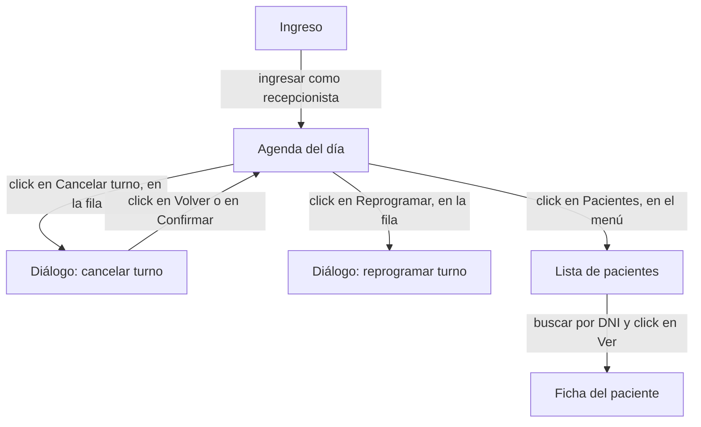

import Activity from '@site/src/components/Activity';
import Quiz from '@site/src/components/Quiz';
import FillBlank from '@site/src/components/FillBlank';
import DecisionPath from '@site/src/components/DecisionPath';
import {useLessonProgress} from '@site/src/hooks/useLessonProgress';
import {
  READ_QUIZ,
  EDGE_TEMPLATE,
  EDGE_SLOTS,
  EDGE_BANK,
  EDGE_EXPLANATION,
  ARRIVE_START,
  ARRIVE_NODES,
  ARRIVE_EXPLANATION,
} from '@site/src/content/lessons/85b-mapa-de-navegacion';

export const LESSON_SLUG = 'ai-ui-mapa-de-navegacion';

export function ReadMapQuizActivity() {
  const {isDone, markDone} = useLessonProgress(LESSON_SLUG, ['readmapquiz']);
  return (
    <Activity
      title="Leer el mapa"
      kind="Elegí la opción"
      goal="seguir un camino en el diagrama y usar los campos requiere y señal de una transición."
      done={isDone('readmapquiz')}
      consigna="Son 3 preguntas sobre el mapa de la agenda de la teoría: el diagrama y el archivo agenda.yaml. Si elegís una opción incorrecta, leé la explicación y elegí otra. Se completa al responder bien las 3."
    >
      <Quiz
        questions={READ_QUIZ}
        onSolved={() => markDone('readmapquiz')}
      />
    </Activity>
  );
}

export function EdgeFillActivity() {
  const {isDone, markDone} = useLessonProgress(LESSON_SLUG, ['edgefill']);
  return (
    <Activity
      title="Una transición y su pantalla"
      kind="Completar huecos"
      goal="escribir en el archivo del mapa una transición y la señal de la pantalla de llegada."
      done={isDone('edgefill')}
      consigna="Desde la lista de pacientes se llega a la ficha buscando por DNI, y para eso tiene que haber un paciente cargado. La ficha se reconoce por su título. Completá los 4 huecos con los nombres de los campos del archivo del mapa y presioná Comprobar. Cada ficha se usa una vez y sobran algunas."
    >
      <FillBlank
        template={EDGE_TEMPLATE}
        slots={EDGE_SLOTS}
        bank={EDGE_BANK}
        explanation={EDGE_EXPLANATION}
        alreadyDone={isDone('edgefill')}
        onSolved={() => markDone('edgefill')}
      />
    </Activity>
  );
}

export function ArrivePathActivity() {
  const {isDone, markDone} = useLessonProgress(LESSON_SLUG, ['arrivepath']);
  return (
    <Activity
      title="Cuando la señal no aparece"
      kind="Escenario encadenado"
      goal="distinguir un mapa desactualizado, un camino roto y una pantalla nueva, y tratar cada uno como corresponde."
      done={isDone('arrivepath')}
      consigna="Son 3 situaciones encadenadas de un agente que recorre el mapa de la agenda. En cada una elegí qué hace; si no es lo correcto, leé el porqué y probá otra. Se completa al llegar al final del recorrido."
    >
      <DecisionPath
        startId={ARRIVE_START}
        nodes={ARRIVE_NODES}
        explanation={ARRIVE_EXPLANATION}
        alreadyDone={isDone('arrivepath')}
        onSolved={() => markDone('arrivepath')}
      />
    </Activity>
  );
}

Un agente que tiene que llegar a una pantalla, sin un mapa, la busca a ciegas. Esta entrada muestra el mapa de navegación: un grafo de pantallas y acciones, dibujado como diagrama y escrito como archivo de datos, cómo lo usa un agente para llegar, comprobar que llegó y detectar cambios, y cómo se arma y se mantiene.

## Conceptos

### El problema: llegar a una pantalla

Le pedís a un agente: «explorá el diálogo de reprogramar un turno». El
agente abre la aplicación con el navegador (entrada de MCP) y empieza a
buscar. Prueba el menú «Agenda», abre un día sin turnos, vuelve, prueba
«Pacientes», abre una ficha. El diálogo no aparece por ningún lado,
porque no tiene dirección propia: se abre desde el botón «Reprogramar»
de la fila de un turno, y ese botón solo existe si hay un turno
reservado. Después de diez minutos y miles de tokens, el agente
concluye que la funcionalidad no existe.

A una persona nueva en el equipo le pasaría lo mismo, y la solución
sería la misma: alguien le dibuja el camino. «Entrás con la
recepcionista, vas a la agenda, buscás un turno reservado, y en su fila
está Reprogramar.» El **mapa de navegación** es ese dibujo, escrito de
forma que un agente lo pueda seguir.

### Un mapa es un grafo de pantallas y acciones

En la entrada de state transition testing viste un sistema descrito
como **estados** y **transiciones**: cada estado es una situación en la
que puede estar el sistema, y cada transición es el evento que lo lleva
de un estado a otro. Un mapa de navegación usa la misma idea para la
interfaz:

- cada **pantalla** es un nodo: una página, pero también un diálogo, un
  panel o una pestaña que el agente tiene que poder reconocer;
- cada **transición** es una flecha: la acción del usuario que lleva de
  una pantalla a otra, como hacer click en «Reprogramar».

Con ese formato, llegar a una pantalla deja de ser una búsqueda a
ciegas: es seguir las flechas desde el inicio hasta el nodo que se
busca.

### El diagrama

Para que una persona lo lea de un vistazo, el mapa se dibuja. Una forma
cómoda es **Mermaid**: un lenguaje de texto que describe diagramas. Se
escribe dentro de un archivo Markdown, GitHub lo muestra dibujado, y un
agente lo lee como texto. El mapa de la agenda:

```text
flowchart TD
  ingreso["Ingreso"] -->|ingresar como recepcionista| agenda["Agenda del día"]
  agenda -->|click en Cancelar turno, en la fila| cancelar["Diálogo: cancelar turno"]
  cancelar -->|click en Volver o en Confirmar| agenda
  agenda -->|click en Reprogramar, en la fila| reprogramar["Diálogo: reprogramar turno"]
  agenda -->|click en Pacientes, en el menú| pacientes["Lista de pacientes"]
  pacientes -->|buscar por DNI y click en Ver| ficha["Ficha del paciente"]
```

- `flowchart TD` dibuja un diagrama de flujo de arriba hacia abajo.
- `ingreso["Ingreso"]` es un nodo: un identificador corto y, entre
  corchetes, el nombre que se muestra.
- `-->|texto|` es una flecha con la acción escrita encima.

Dibujado, queda así:



### Lo que el diagrama no alcanza a decir

El diagrama muestra el camino, pero un agente que lo sigue necesita
tres datos más, que no entran en una flecha:

- **cómo sabe que llegó**: si después del click está en el diálogo de
  reprogramar o en otra cosa;
- **qué tiene que existir antes**: sin un turno reservado, la flecha
  «Reprogramar» no se puede recorrer;
- **si la flecha sigue siendo cierta**: cuándo se comprobó por última
  vez.

Por eso, además del diagrama, el mapa tiene un archivo de datos, por
ejemplo `docs/mapa/agenda.yaml`, en formato YAML, el mismo de los
workflows de GitHub Actions (entrada de CI con GitHub Actions):

```yaml
inicio: ingreso

pantallas:
  agenda:
    nombre: Agenda del día
    ruta: /agenda?fecha={fecha}
    rol: recepcionista
    señal: heading "Agenda del día"
    casos_de_uso: [UC-03, UC-07, UC-08]
  reprogramar:
    nombre: Diálogo de reprogramar turno
    señal: dialog "Reprogramar turno"
    casos_de_uso: [UC-09]
  # ... el resto de las pantallas

transiciones:
  - desde: agenda
    hacia: reprogramar
    accion: click en button "Reprogramar" de la fila del turno
    requiere: un turno Reservado a futuro
    verificada: 2026-10-28
  # ... el resto de las transiciones
```

Cada campo responde una pregunta del agente:

| Campo | Pregunta que responde |
| :- | :- |
| `inicio` | ¿Desde dónde empiezo? |
| `ruta` | ¿Tiene una dirección para ir directo? Los diálogos no la tienen |
| `rol` | ¿Con qué cuenta tengo que estar? |
| `señal` | ¿Cómo sé que llegué? Un elemento con su rol y su nombre, como en el árbol de accesibilidad (entrada de MCP) |
| `accion` | ¿Qué hago para pasar a la pantalla siguiente? |
| `requiere` | ¿Qué datos tienen que existir antes? |
| `verificada` | ¿Cuándo se comprobó por última vez que esta flecha funciona? |
| `casos_de_uso` | ¿Qué funcionalidades se prueban en esta pantalla? Une el mapa con los casos de uso (entrada de casos de uso) |

El archivo YAML es la fuente: el diagrama se genera a partir de él, con
un script o pidiéndoselo a un agente, para que los dos digan siempre lo
mismo.

### Cómo lo usa un agente

Con el mapa, el pedido «explorá el diálogo de reprogramar» se resuelve
en pasos fijos:

1. **Buscar el camino.** Desde `inicio`, seguir las transiciones hasta
   `reprogramar`: ingreso → agenda → reprogramar. Es la misma búsqueda
   que hace un GPS: entre todos los caminos posibles, el más corto.
2. **Preparar lo que se requiere.** La flecha a `reprogramar` requiere un
   turno reservado a futuro: el agente lo crea antes de empezar, con la
   herramienta de datos (entrada de entornos y datos para agentes).
3. **Recorrer y comprobar.** En cada paso hace la acción y busca la
   señal de la pantalla de llegada. Si aparece `dialog "Reprogramar
   turno"`, llegó.

Si en algún paso la señal no aparece, hay tres casos, y cada uno se
trata distinto:

- **La pantalla es la correcta, pero cambió.** El diálogo ahora se
  titula «Cambiar horario». El mapa quedó desactualizado: el agente
  propone el cambio de la señal, y una persona lo revisa.
- **Llegó a otra pantalla.** El click llevó a la ficha del paciente. El
  camino está roto, o la aplicación tiene un defecto: el agente no
  corrige el mapa, avisa.
- **Llegó a una pantalla que el mapa no tiene.** Es una pantalla nueva:
  el agente la agrega, marcada como «a confirmar».

La diferencia entre el primer caso y el segundo es la misma que entre
un locator desactualizado y un defecto (entrada de revisar lo que
produce): corregir el mapa cuando el que está mal es la aplicación
esconde el problema.

### Cómo se arma

Escribir el mapa a mano, pantalla por pantalla, es lento. Lo habitual
es que lo arme un agente y una persona lo revise:

1. **Exploración desde el inicio.** Un agente con el servidor MCP de
   Playwright parte de `inicio` y recorre la aplicación por niveles:
   primero todo lo que sale de la pantalla inicial, después todo lo que
   sale de cada una de esas, y así. A cada pantalla nueva le registra
   una señal; a cada acción que lleva de una a otra, una transición.
2. **Todo queda «a confirmar».** Lo que registró el agente es lo que vio,
   no necesariamente lo que tiene que ser. Una persona revisa cada
   pantalla y cada flecha, completa los `requiere` que el agente no pudo
   saber, y recién ahí lo marca como confirmado.
3. **Primero los flujos críticos.** No hace falta mapear toda la
   aplicación de una vez: se empieza por las pantallas de los casos de
   uso más riesgosos, y el mapa crece a medida que se usa.
4. **En el repositorio**, revisado en Pull Requests, como los casos de
   uso.

### Mantenerlo vivo

Un mapa que nadie actualiza termina mandando a los agentes por caminos
que ya no existen. Dos prácticas lo evitan:

- **Cada recorrido verifica.** Cada vez que un agente recorre una flecha
  con éxito, actualiza su `verificada`. Una flecha que hace meses que
  nadie recorre es la primera sospechosa cuando algo falla.
- **Los cambios pasan por una persona.** El agente propone; el mapa se
  actualiza en un Pull Request, como cualquier documento del proyecto.

### Mapa y casos de uso

Son dos documentos que se complementan:

- el **caso de uso** dice qué tiene que pasar en una funcionalidad
  (entrada de casos de uso);
- el **mapa** dice cómo se llega a cada pantalla donde eso pasa.

El campo `casos_de_uso` de cada pantalla los une: para explorar UC-09,
el agente busca en el mapa la pantalla que lo menciona, y sabe a dónde
ir.

### ¿Está listo el mapa?

- ¿Cada pantalla de los flujos críticos está en el mapa, con su señal?
- ¿Cada transición tiene su acción y lo que requiere?
- ¿Los diálogos y paneles sin dirección propia están como pantallas?
- ¿Lo que armó un agente está revisado por una persona?
- ¿El diagrama se genera desde el archivo, y no se mantiene a mano?

## Cuándo usarlo

Antes de que un agente tenga que llegar solo a una pantalla: para
explorar, reproducir un fallo o capturar una pantalla. Se empieza por
los flujos críticos y se completa con el uso.

## Buenas prácticas

- Pantallas con una señal concreta, por rol y nombre.
- Transiciones con su acción, lo que requieren y la fecha en que se
  verificaron.
- El archivo de datos como fuente, y el diagrama generado a partir de él.
- Lo que arma un agente, revisado por una persona.

## Anti-patrones

- **Dejar que el agente busque** cada vez el camino a una pantalla.
- **Un diagrama sin datos**: muestra el camino pero no cómo saber que se
  llegó.
- **Corregir el mapa** cuando el agente llegó a otra pantalla.
- **Un mapa que nadie verifica.**

## Práctica

Estos son los 3 ejercicios de práctica de la entrada, en orden. Cada uno es independiente y tiene su propia consigna; cada bloque avisa cuando está resuelto.

<ReadMapQuizActivity />

<EdgeFillActivity />

<ArrivePathActivity />
